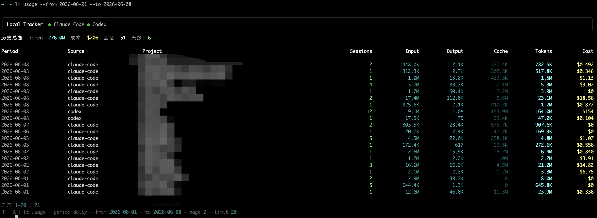
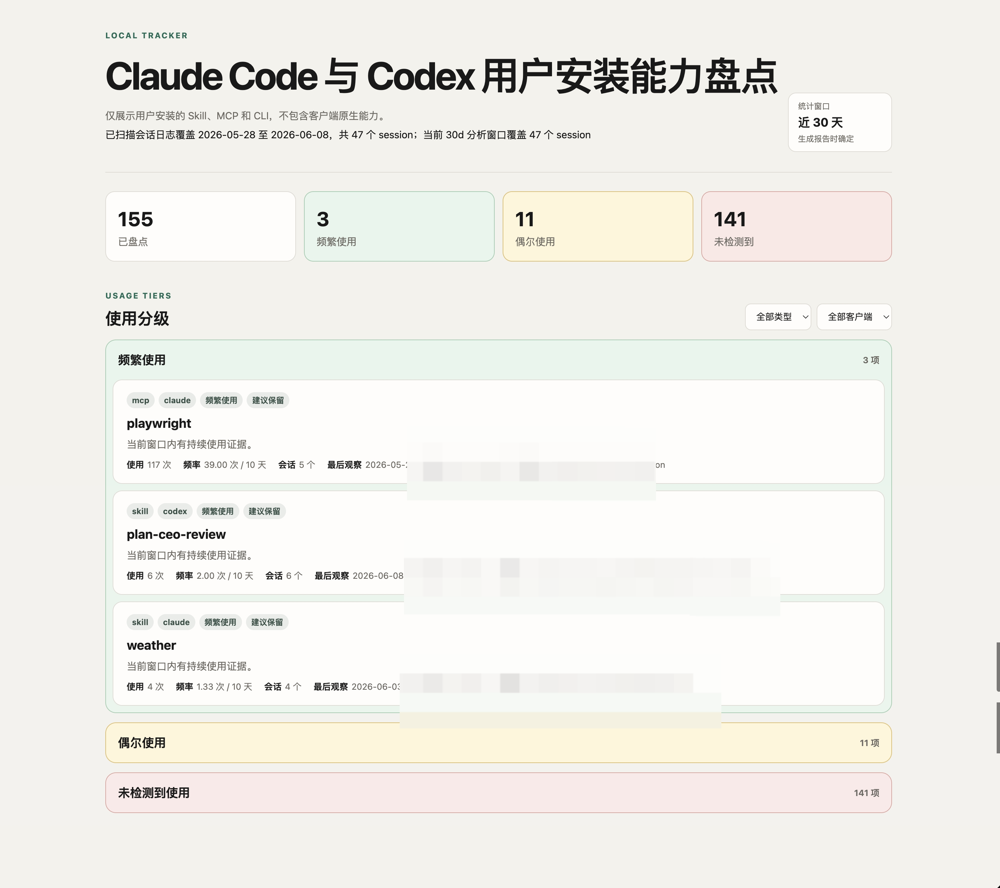
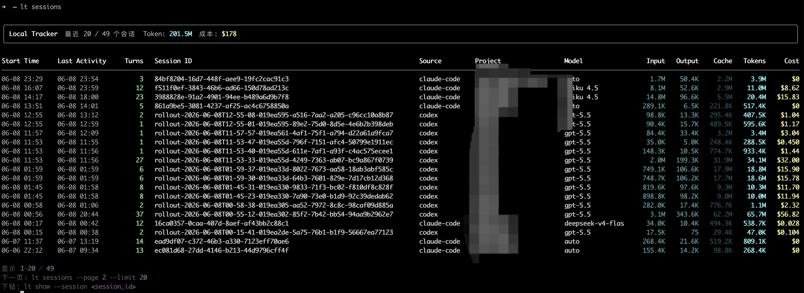
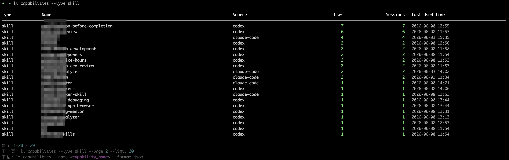
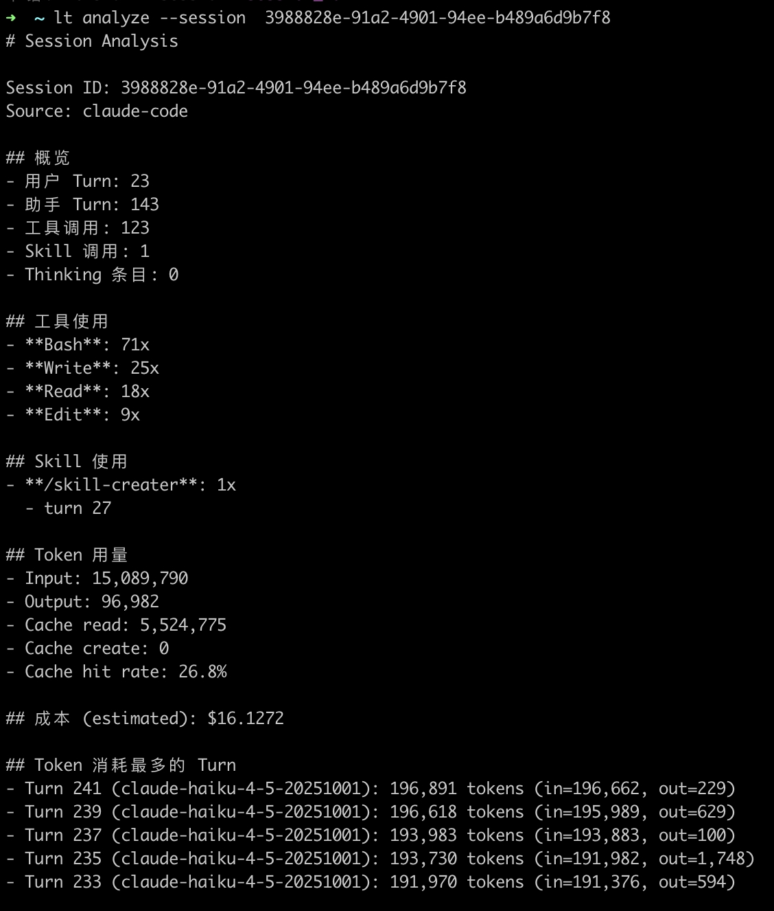

# Local Tracker Suite

`local-tracker-suite` 是 `local-tracker` CLI 与 `local-tracker-skill` 的组合仓库，用于在本机查看 Claude Code / Codex session、token/cost 用量和 Skill/MCP/CLI 能力使用证据。

## 产品组成

- `packages/cli`：可独立安装的 `lt` CLI。它是数据底座，直接读取本机 Claude Code / Codex 写入的 JSONL session 文件，输出表格、Markdown 或版本化 JSON。



- `packages/skill`：可选的对话入口。Skill 不直接解析 session 文件，只调用本机已安装的 `lt` 命令，帮助用户用自然语言查询 session、用量和能力盘点。
- 静态 HTML 报表：Skill 能生成单文件能力盘点页，按“频繁使用、偶尔使用、未检测到使用”分组展示用户安装的 Skill/MCP/CLI 使用证据。



## 市场安装与使用

市场发布包根目录直接包含 `SKILL.md`，符合标准 Skill 结构。自包含 CLI ZIP 随 Skill
保存在 `assets/local-tracker-cli.zip`，不需要用户另外下载安装包。

标准 Skill 市场没有通用安装后钩子，因此市场安装时会同时下载 CLI ZIP，但不会立即
执行本机写操作。Skill 首次使用时如果检测不到 `lt`，会运行：

```bash
python3 "$SKILL_DIR/scripts/install_cli.py"
```

安装器会将 CLI ZIP 复制到用户级数据目录，默认位置为
`~/.local/share/local-tracker/local-tracker-cli.zip`，并在 `~/.local/bin/lt`
创建命令入口。CLI ZIP 已包含运行依赖，安装过程不调用 `pip`、不访问网络。
安装完成后，用户既可以继续通过 Skill 进行自然语言查询，也可以直接使用 CLI：

```bash
lt --help
lt sessions --limit 8 --sort tokens
lt usage --period daily --limit 10 --sort tokens
lt capabilities --limit 12 --sort uses
```

## CLI 与 Skill 的关系

- CLI 是唯一数据接口：session、usage、capability audit 都由 `lt` 命令提供。
- Skill 是对话层：把用户自然语言意图路由到 `lt sessions`、`lt usage`、`lt capabilities`、`lt audit` 或报表脚本。
- Skill 不导入 CLI Python 内部模块，不实现备用扫描器；如果 `lt` 不存在或命令失败，应提示安装或版本不兼容。
- 需要脚本化、导出 JSON 或精确过滤时直接使用 CLI；需要对话式解释和静态报表时使用 Skill。

## 常见能力

- 查询最近 session、项目 session 和单个 session 详情。
- 查看 session 轮次、最后对话时间、token 与成本消耗。
- 按日期范围、项目或客户端分析 usage。
- 盘点用户安装的 Skill、MCP 和 CLI。
- 生成能力盘点 HTML 页面，辅助判断哪些能力值得保留、清理或后续停用。







能力盘点页的目的不是替用户自动删除插件，而是把安装状态和可观测使用证据整理清楚，让用户更快决策。

## 数据口径

- `Cost` 优先采用客户端日志中的费用；日志没有费用时，CLI 参考 LiteLLM 模型价格表或内置备用价格，分别计算 input、output、cache creation 和 cache read 后求和。该值用于本地趋势分析，不等同于服务商账单。
- Codex Skill 和 shell/exec 中的 CLI 使用记录采用启发式识别，可能存在漏检或误识别；MCP 和客户端原生工具只有在日志提供稳定结构化工具名时才按精确证据记录。
- 能力清理或停用前应查看 `detection_method`、日志覆盖范围和原始 session，不能将“未检测到”直接解释为“从未使用”。

## 目录结构

```text
packages/
  cli/      # local-tracker CLI
  skill/    # local-tracker-skill
docs/
  README.md
  assets/screenshots/
scripts/
  build-skill-zip.sh
  install-local.sh
tests/
  test_release_layout.py
```

## 隐私与安全

- 数据纯本地处理，不上传遥测，不依赖代理，不拦截网络流量。
- CLI 默认只读取本地 session 文件；能力禁用/恢复类命令需要显式 `--confirm`。
- Skill 报表只生成单文件静态 HTML，不启动本地服务。
- HTML 报表可能包含本地路径、项目名、能力名、session 覆盖范围、token/cost 和使用证据，分享前必须脱敏。
- `.claude/`、`.codex/`、子目录内 agent 私有规则文件只属于本地协作环境，不进入发布物。

## 文档入口

| 文档 | 用途 |
|---|---|
| [`docs/README.md`](docs/README.md) | 文档结构、截图命名、脱敏约定和长期文档索引。 |
| [`packages/cli/README.md`](packages/cli/README.md) | CLI 快速入门、常用命令、安全边界和字段词典入口。 |
| [`packages/cli/docs/FIELDS.md`](packages/cli/docs/FIELDS.md) | CLI 公开字段词典。 |
| [`packages/skill/SKILL.md`](packages/skill/SKILL.md) | Skill 的触发条件、执行顺序、命令路由和安全约束。 |

## 验证

```bash
python3 -m unittest discover -v
```

## 构建发布制品

```bash
bash scripts/build-release.sh
```

制品写入 `target/`：

- `local-tracker-skill-v<version>.zip`：Skill 市场发布包，根目录包含 `SKILL.md`，并内置 `assets/local-tracker-cli.zip`。
- `SHA256SUMS`：市场发布包的 SHA-256 校验值。

发布构建使用两层文件白名单。外层 Skill ZIP 不包含 README、测试、内部文档、Git
元数据、Agent 协作规则、缓存、日志、运行报表和本地配置；内层 CLI ZIP 只包含
启动入口、CLI 源码、固定版本的纯 Python 运行依赖和许可证。

## License

MIT
